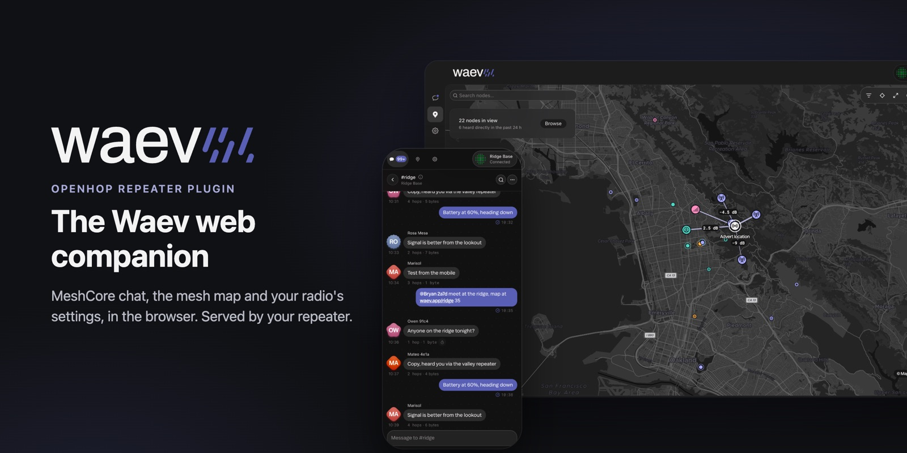
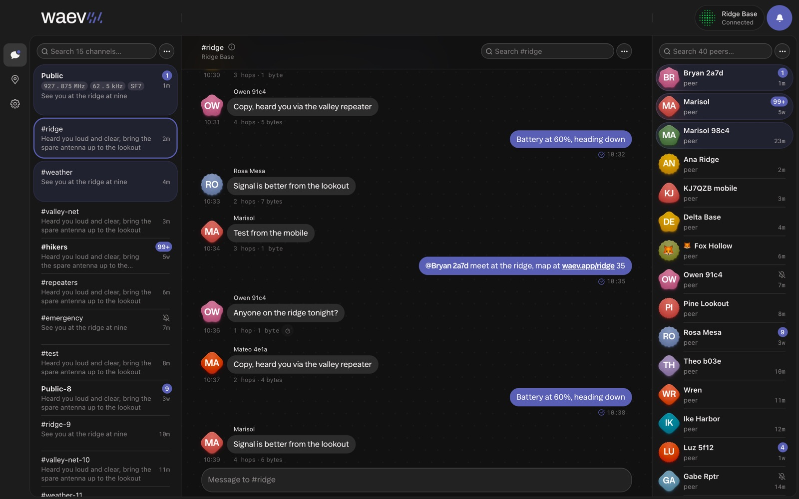
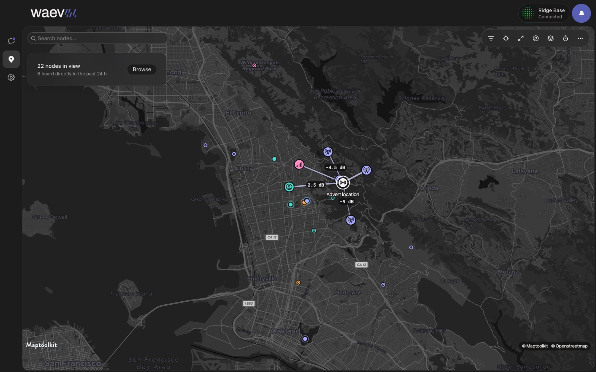
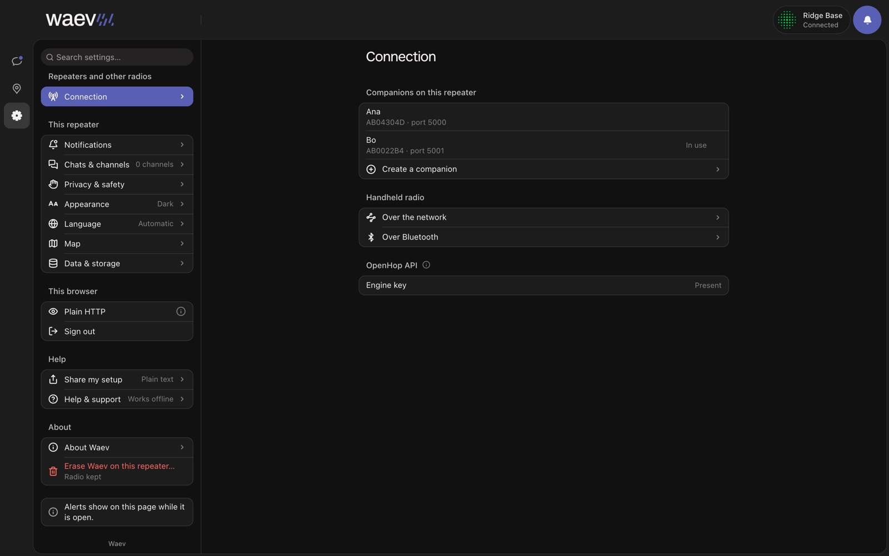
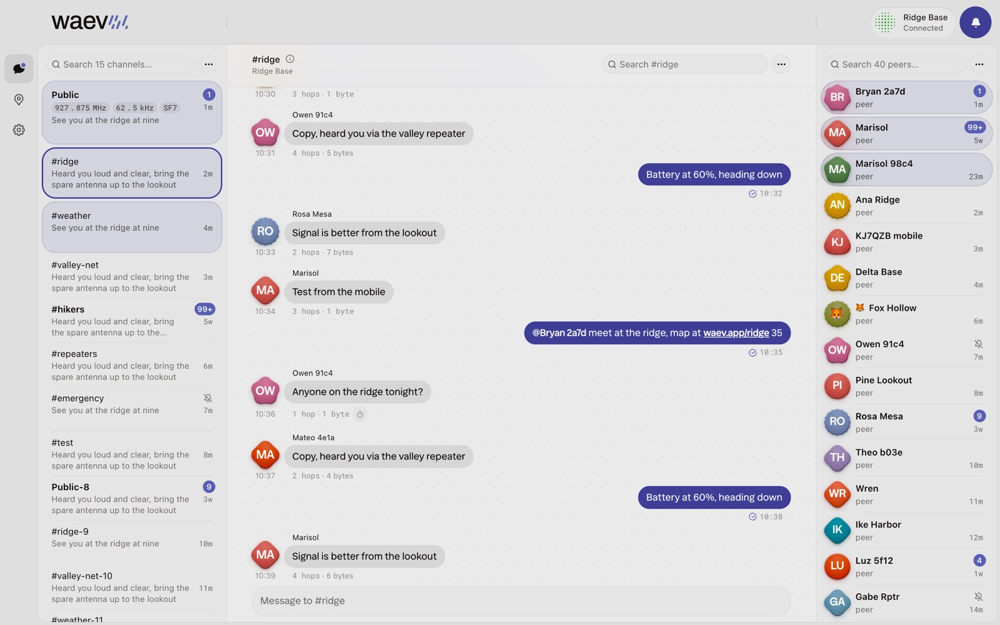
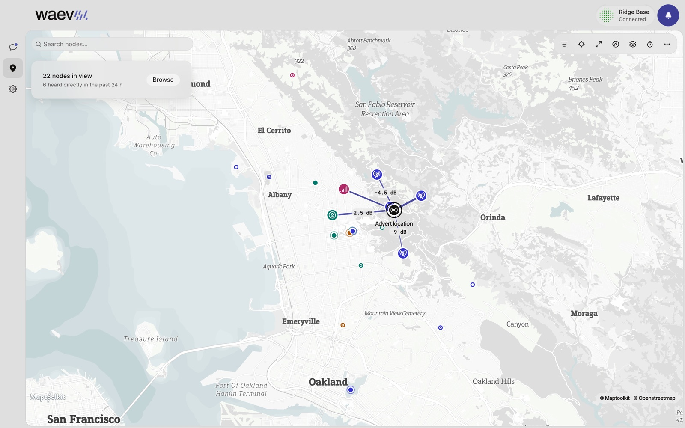

  

<h1 align="center">Waev web companion</h1>

Your MeshCore mesh, in any browser on your network. Served by your <a href="https://github.com/openhop-dev/openhop_repeater">openHop Repeater</a>. Nothing else to run.

  
  
  

  <a href="#install">Install</a> ·
  <a href="#what-you-get">What you get</a> ·
  <a href="#how-it-works">How it works</a> ·
  <a href="#your-data">Your data</a> ·
  <a href="#releases">Releases</a> ·
  <a href="#support">Support</a>

 

Waev is a MeshCore companion for iPhone, Mac and Android. This plugin puts the
same engine on your repeater and serves Waev to any browser on your network:
channels and direct messages, the mesh map, and every setting a companion
needs. Sign in with your repeater's password, choose a radio, and you're on
the mesh.

## Install

1. Download the wheel from the [latest release](https://github.com/Treehouse-00/waev-companion/releases/latest).
2. In your repeater's interface, open **System → Plugins → Install plugin wheel**, pick it, and **Enable** `waev.companion`.
3. **Open UI**, sign in with the repeater's password, and choose a radio on **Settings › Connection**.

Needs openHop Repeater 1.1.2 or later on a Raspberry Pi or Debian host, and
port 8792 open on your network. [INSTALL.md](INSTALL.md) has the details,
upgrades, Bluetooth handhelds, moving from `waev.push`, and removal.

## What you get

**Chat that shows the mesh.** Channels and direct messages, with every
message's hops and size and how far your own got. Search, favourites, mute
and unread counts.

**A map of who hears whom.** Every node in view, with a line to each one your
radio heard directly: its width is the signal, its strength is how recently.
Show a message's route on the map, filter by kind, and browse what's near.

**Any radio you have.** Use a companion your repeater already hosts, create a
new one with its own identity, or reach a handheld over the network or
Bluetooth. Nothing is chosen for you.

  
  

**Light and dark, desk and pocket.** The page fits a monitor and a phone, and
keeps the appearance and language you choose.

**Push for the Waev apps**, off until you turn it on. It replaces the
`waev.push` plugin and imports its registrations.

Screenshots show Waev's built-in demo data.

## How it works

The plugin runs the Waev engine beside your repeater, as its own service.
The repeater serves the page at `/plugins/waev.companion/`; the page talks
to the engine over a WebSocket on port 8792.

On a companion the repeater hosts, Waev is a guest. It attaches only while
you're using it, lets go when you're not, and never takes a message queued
for a phone. Every phone receives exactly what it would without the plugin.

Waev never transmits on its own. Messages, traces and adverts go out when you
send them, and adverts only on your action or your schedule.

## Your data

Everything stays on your repeater, in the plugin's `data/` folder: the chat
history, the companion choice, the engine's key for the repeater's API, and
push's registrations when push is on. Nothing is sent anywhere unless you
turn on push, which seals each notification end to end before it leaves and
passes it through Waev's relay to Apple or Google as ciphertext. The map
loads its tiles from [Maptoolkit](https://www.maptoolkit.org/) in your
browser.

Waev connects to independent, user-operated MeshCore networks. It does not
operate or moderate them; messages may be relayed or stored by other
participants, identities can change, and what's transmitted cannot be
recalled. Waev gives you local filtering, blocking, hiding and reporting.
[Communication Safety & Acceptable Use](https://support.waev.app/acceptable-use/)
says more.

## Releases

Each [release](https://github.com/Treehouse-00/waev-companion/releases)
carries the wheel, its `SHA256SUMS`, `THIRD_PARTY_NOTICES.md`, and notes
naming the exact source commit it was built from. Waev's source isn't
public; [RELEASE.md](RELEASE.md) explains the version numbers, how a release
is built and how to check a download. [CHANGELOG.md](CHANGELOG.md) lists
what changed.

## Support

Open an [issue](https://github.com/Treehouse-00/waev-companion/issues), or
write to [admin@waev.app](mailto:admin@waev.app). Include the plugin version,
your repeater's version, and what the plugin's **Logs** action shows.

## Licence

Free to download, install and use under the
[Waev web companion licence](LICENSE). Not open source. Bundled third-party
components keep their own licences, listed in each release's
`THIRD_PARTY_NOTICES.md`.

Maintained by Treehouse · <a href="https://waev.app">waev.app</a>

